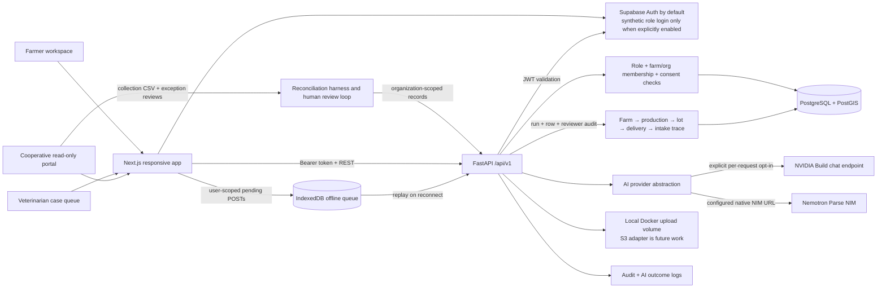

# Terravanta architecture



## Application and data boundaries

- The API is the source of truth. Every protected operation authenticates the user, checks server-side role and farm/organization membership, validates UUIDs and payloads, and audits sensitive changes. A cooperative request is filtered by active, non-expired consent and `delivery_summary` scope on every call.
- Farmer-created farm, crop, feed, health, production and delivery records are attributed to their source. A veterinarian can verify a health event only on an assigned farm. Verification records the veterinarian; AI output is stored separately and never signs or edits that record.
- The cooperative portal returns the permitted delivery summary, the synthetic/source indicator, and a missing-reference prompt derived from those shared fields. Veterinary, animal-level and quality/lab records are not included in that scope.
- Cooperative reconciliation accepts a bounded UTF-8 CSV, matches only farm-consented same-date milk deliveries in litres, persists every row status, and routes uncertain rows to an assigned cooperative reviewer. Each read re-checks consent before returning farm/lot/delivery graph nodes. Confirming an exception records a cooperative decision; it does not edit a farm's source record or authorize payment.
- Supabase JWTs are validated against the project's JWKS and issuer/audience. When a project uses legacy shared-secret signing, the API validates the bearer token with the Supabase Auth user endpoint. Before onboarding, the API also checks the provider's current user profile and confirmed-email timestamp. A first confirmed farmer session provisions a farmer-only Terravanta user row; veterinarian and cooperative roles are operator-assigned. Roles and memberships are held in the application database.
- Pilot veterinarian/cooperative accounts are provisioned with the private `python -m app.operator` CLI after a Supabase Auth invitation. The command cannot assign platform-admin access and is not reachable over HTTP. Cooperative delivery sharing may target a verified cooperative account email while a cooperative directory is being onboarded.
- Synthetic records and demo login are off by default and require `ENABLE_SYNTHETIC_DATA=true`; they cannot be enabled in production.
- Supabase refresh tokens are stored in an HttpOnly, SameSite cookie by a same-origin Next.js Route Handler. The browser keeps the short-lived access token in memory and sends it to FastAPI as a bearer token. Production still needs a CSRF/XSS/session-revocation review.
- The offline queue records an owner ID and only replays records for the current browser account. It does not encrypt data, resolve concurrent edits, support multi-device merge, or queue every HTTP method.

## AI provider and evidence flow

```text
Authenticated request
  → authorization and explicit external-processing consent
  → animal history + approved knowledge-source retrieval
  → versioned prompt and NVIDIA provider abstraction
  → timeout/retry handling + safety check + structured validation
  → draft answer, citations, outcome/latency log and audit event
```

The chat adapter uses NVIDIA's OpenAI-compatible endpoint with configurable model ID `nvidia/nemotron-3.5-lightning-30b-a3b`. The API key stays on the backend. If the key is absent or the provider fails, ordinary record operations continue and the assistant returns a clear no-answer state. The selected Build model card does not list Swahili support; no language-specific AI capability is promised.

Selectable PDF text is extracted locally. The image parser uses the native Nemotron Parse NIM contract (multipart `POST /v1/parse`) at an explicitly configured `NVIDIA_PARSE_URL`; it is not silently represented as a hosted Build API. When enabled, the parsed content may go to the configured chat model for structured field extraction. Every extraction stays in `pending_review` until a person checks it; review does not write the values into official records. NVIDIA endpoints, trial terms and data retention must be checked against the deployment account before transmitting real records.

## Data model and migration strategy

The SQLAlchemy models use UUID primary keys, foreign keys, timestamps, audit fields and farm/organization indexes. Tables cover users and roles, organizations and members, farm membership and consent, farms, plots/crops, herds/animals/health events and veterinary subrecords, feed and compost, production/lots/deliveries/buyers, cooperative reconciliation runs/rows, quality/lab records, AI requests/responses/prompts/feedback, document extractions, knowledge sources and audit logs.

The initial Alembic revision creates the schema from model metadata, enables PostGIS on PostgreSQL, and adds a WGS84 farm point with a GiST index. Local SQLite is supported for quick development but has no PostGIS behavior. Production API startup verifies database connectivity without seeding demo records; Docker Compose runs `alembic upgrade head` before starting the API.

## Operational boundaries

- Compose maps ports to loopback and stores uploads in a local Docker volume. Production needs private networking, managed PostGIS, private object storage, file scanning, backups and restore drills.
- The first release uses transparent rules for follow-up, inventory and production anomalies. It does not run Kumo forecast/anomaly services or claim validated prediction.
- API documentation is generated by FastAPI at `/docs`; health is at `/health`.
- Market entry is deliberately narrower than the data model. See [the market wedge and pilot plan](GO_TO_MARKET.md) for the farmer/cooperative jobs, PMF gates and expansion sequence.
- `docker-compose.production.yml`, `Caddyfile`, and [deployment instructions](DEPLOYMENT.md) provide a gated GHCR-to-VPS rollout path. A cooperative service's success criteria and non-automated decision boundary are in [the reconciliation contract](COOPERATIVE_RECONCILIATION.md).
