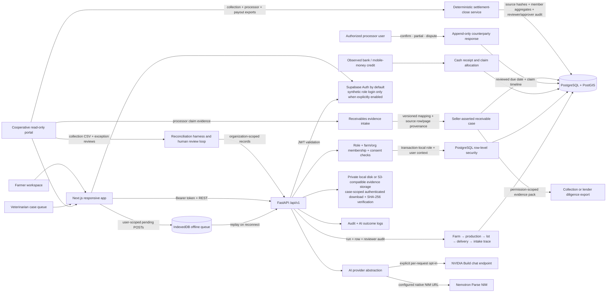

# Terravanta architecture



## Application and data boundaries

- The API is the source of truth. Every protected operation authenticates the user, checks server-side role and farm/organization membership, validates UUIDs and payloads, and audits sensitive changes. A cooperative request is filtered by active, non-expired consent and `delivery_summary` scope on every call.
- PostgreSQL RLS is a second boundary beneath FastAPI. Each authenticated request uses a restricted `terravanta_runtime` login, assumes the non-login `terravanta_app` role inside each transaction, and binds the verified Supabase user UUID through a transaction-local setting. The role is not the table owner and cannot bypass RLS. Alembic and the private operator CLI use the separate owner connection.
- Farmer-created farm, crop, feed, health, production and delivery records are attributed to their source. A veterinarian can verify a health event only on an assigned farm. Verification records the veterinarian; AI output is stored separately and never signs or edits that record.
- The cooperative portal returns the permitted delivery summary, the synthetic/source indicator, and a missing-reference prompt derived from those shared fields. A narrow database projection supplies farm name/code; delivery-summary consent does not authorize general farm, animal, clinical, crop, location or laboratory reads.
- Cooperative reconciliation accepts a bounded UTF-8 CSV, matches only farm-consented same-date milk deliveries in litres, persists every row status, and routes uncertain rows to an assigned cooperative reviewer. Each read re-checks consent before returning farm/lot/delivery graph nodes. Confirming an exception records a cooperative decision; it does not edit a farm's source record or authorize payment.
- Cooperative settlement close accepts three bounded CSV exports, normalizes exact member codes, compares period milk volume, processor gross/deductions/net arithmetic and payout values using decimal arithmetic, and persists fixed-precision amounts plus source hashes, row provenance and references. Exceptions require a named reviewer note; close approval requires a named cooperative user and an approval note. The statement-pack CSV is gated on approval and contains imported values; no endpoint sends a payment, edits a source ledger or declares funds paid.
- Cooperative settlement close is the **member-payable** workflow: it compares cooperative collection, processor settlement and member payout exports. It does not prove the processor's **seller-side receivable**. The receivables assurance domain is kept separate so member liabilities cannot be confused with processor obligations.
- The receivables assurance domain stores seller-owned processor relationships, contract snapshots, evidence metadata, seller assertions and lines, processor responses, observed cash receipts/allocations, pilot decision records and append-only claim events. Dedicated FastAPI routes and seller/processor screens implement the manual workflow. Composite foreign keys bind artifacts and cases to the seller organization; response rows bind to the case's declared processor organization and a processor member. The processor UI shows only claims submitted to that organization.
- Receivables data preserves each party's position. `asserted`, `counterparty_confirmed`, `disputed` and `received` remain separate values. Aging uses a seller-reviewed due date, or an already confirmed contract snapshot, and returns the date basis; it is an operational calculation, not a legal conclusion. Cash rows describe receipts and allocations already observed and cannot initiate transfers. Every read/write checks role and organization membership in the API.
- A lender pack requires a separate explicit sharing mandate and the lender's own role/access check. Cooperative records remain private to the seller by default; veterinary records are not part of receivables diligence. Retention, legal authority, member data minimization, counterparty confidentiality and deletion must be agreed before loading live files.
- Supabase JWTs are validated against the project's JWKS and issuer/audience. When a project uses legacy shared-secret signing, the API validates the bearer token with the Supabase Auth user endpoint. Before onboarding, the API also checks the provider's current user profile and confirmed-email timestamp. A first confirmed farmer session provisions a farmer-only Terravanta user row; cooperative and processor roles are operator-assigned. Roles and memberships are held in the application database.
- Pilot veterinarian/cooperative/processor accounts are provisioned with the private `python -m app.operator` CLI after a Supabase Auth invitation. The command cannot assign platform-admin access and is not reachable over HTTP. Cooperative delivery sharing may target a verified cooperative account email while a cooperative directory is being onboarded.
- Synthetic records and demo login are off by default and require `ENABLE_SYNTHETIC_DATA=true`; they cannot be enabled in production.
- Supabase refresh tokens are stored in an HttpOnly, SameSite cookie by a same-origin Next.js Route Handler. The browser keeps the short-lived access token in memory and sends it to FastAPI as a bearer token. The email-code sign-in path is removed. Production still needs a CSRF/XSS/session-revocation review and staging validation of all RLS roles.
- The offline queue records an owner ID and only replays records for the current browser account. It does not encrypt data, resolve concurrent edits, support multi-device merge, or queue every HTTP method.

## AI provider and evidence flow

```text
Authenticated request
  → authorization and explicit external-processing consent
  → animal history + approved knowledge-source retrieval
  → versioned prompt and NVIDIA provider abstraction
  → timeout/retry handling + safety check + structured validation
  → draft answer, citations, outcome/latency log and audit event
```

The chat adapter uses NVIDIA's OpenAI-compatible endpoint with configurable model ID `nvidia/nemotron-3.5-lightning-30b-a3b`. The API key stays on the backend. If the key is absent or the provider fails, ordinary record operations continue and the assistant returns a clear no-answer state. The selected Build model card does not list Swahili support; no language-specific AI capability is promised.

Selectable PDF text is extracted locally. The image parser uses the native Nemotron Parse NIM contract (multipart `POST /v1/parse`) at an explicitly configured `NVIDIA_PARSE_URL`; it is not silently represented as a hosted Build API. When enabled, the parsed content may go to the configured chat model for structured field extraction. Every extraction stays in `pending_review` until a person checks it; review does not write the values into official records. NVIDIA endpoints, trial terms and data retention must be checked against the deployment account before transmitting real records.

## Data model and migration strategy

The SQLAlchemy models use UUID primary keys, foreign keys, timestamps, audit fields and farm/organization indexes. Tables cover users and roles, organizations and members, farm membership and consent, farms, plots/crops, herds/animals/health events and veterinary subrecords, feed and compost, production/lots/deliveries/buyers, cooperative reconciliation runs/rows, member settlement closes, receivable counterparties/contracts/cases/lines/evidence/mapping profiles/confirmations/cash receipts and allocations/events, quality/lab records, AI requests/responses/prompts/feedback, document extractions, knowledge sources and audit logs.

The initial Alembic revision creates the schema from model metadata, enables PostGIS on PostgreSQL, and adds a WGS84 farm point with a GiST index. Local SQLite is supported for quick development but has no PostGIS behavior. Production API startup verifies database connectivity without seeding demo records; Docker Compose runs `alembic upgrade head` before starting the API.

## Operational boundaries

- Compose maps ports to loopback and stores receivable evidence in a private Docker volume. Render uses a private persistent disk at one API instance by default; a private S3-compatible backend is configurable for future scale-out. Upload types and sizes are constrained, file names are not used as storage keys, each download is authorized and hashes are checked. Virus scanning, automatic retention/deletion and backup/restore drills are still required for full production controls.
- The first release uses transparent rules for follow-up, inventory and production anomalies. It does not run Kumo forecast/anomaly services or claim validated prediction.
- Neither the member settlement-close core nor the receivables workflow depends on NVIDIA. Contract management, source adapters, malware scanning, an automated retention worker and lender/collection portal remain future implementation. AI extraction may create reviewable drafts later, but cannot create amounts, determine legal due dates, confirm debt, allocate funds or decide credit. See [receivables assurance](RECEIVABLES_ASSURANCE.md) and [member settlement close](SETTLEMENT_CLOSE.md).
- API documentation is generated by FastAPI at `/docs`; health is at `/health`.
- Market entry is deliberately narrower than the data model. See [the market wedge and pilot plan](GO_TO_MARKET.md) for the farmer/cooperative jobs, PMF gates and expansion sequence.
- GitHub Actions validates API tests, PostGIS migrations, and the web build. Render deploys after checks pass; Vercel Git integration creates production deployments and should hold promotion on those GitHub checks. The separate `docker-compose.production.yml` and `Caddyfile` are optional self-managed files, not the production CI/CD path. A cooperative service's success criteria and non-automated decision boundary are in [the reconciliation contract](COOPERATIVE_RECONCILIATION.md).
