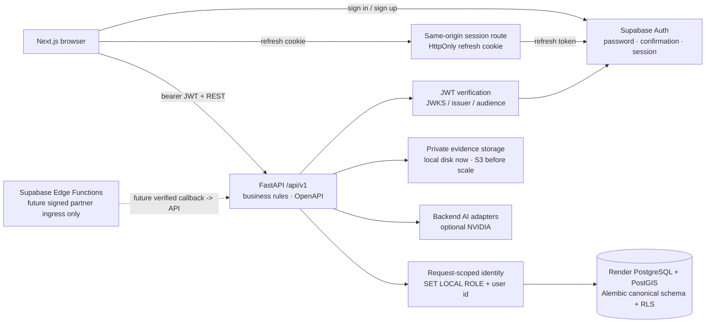

# Terravanta core platform architecture

## Decisions

Terravanta uses one canonical operational database and one domain API. Supabase owns user credentials and authentication; Render PostgreSQL/PostGIS owns the farm, animal, production, cooperative, settlement, receivable, evidence metadata and audit records already used by the product. FastAPI remains the only public business API. The Next.js browser sends a Supabase bearer token to `/api/v1`; it never receives database credentials or a service-role key.

This keeps the existing Render database and its Alembic history intact while removing the custom email-code identity path. It avoids a dual-write system in which a farm record could succeed in one database and fail in another. Supabase's direct Data API is not enabled as an alternate write path for the operational data.

## Authentication and onboarding

1. The browser uses the dedicated Terravanta Supabase Auth project for email/password sign-up and sign-in. Supabase performs email confirmation and issues/rotates tokens.
2. The refresh token is stored in an HttpOnly cookie on the Terravanta web origin. The access token stays in memory and is sent only as a bearer token to FastAPI.
3. FastAPI validates the token's signature, issuer and audience against Supabase JWKS. For a legacy signing setup, the API additionally asks Supabase Auth to validate the current user.
4. `/api/v1/auth/onboard` confirms the current email with Supabase, then invokes a restricted PostgreSQL provisioning function. New accounts get only the `farmer` role. A confirmed email matching a legacy farmer record links the Supabase subject to the existing Terravanta user UUID, preserving its farm history. Existing staff or conflicting identities are rejected for operator review. Editable Auth metadata never grants roles.
5. Veterinarian, cooperative and processor access is assigned by a trusted operator after the Supabase identity exists. User role and farm/organization membership records live in PostgreSQL, not client claims.
6. The removed email-code endpoints are not aliases for Supabase login. Existing users must use their Supabase password account; account recovery is handled by Supabase Auth configuration.

The frontend's public Supabase URL and anon/publishable key are not secrets. A service-role key must never be used in the browser, exposed as `NEXT_PUBLIC_*`, or checked in.

## Database and transaction boundary

Alembic migrations are the schema authority. SQLAlchemy models map the business tables; PostGIS stores WGS84 farm locations. Render's owner credential is reserved for Alembic and trusted operator work. The API uses a separate `terravanta_runtime` login which can assume the non-login `terravanta_app` role. That role has only `SELECT`, `INSERT` and `UPDATE` grants on the app table allowlist, has `NOBYPASSRLS`, and receives no `DELETE` or DDL grant.

For each authenticated API request, `get_scoped_db` binds the verified Supabase `sub` to the SQLAlchemy session. At the beginning of each PostgreSQL transaction—including a transaction opened after a handler commits—the session hook runs `SET LOCAL ROLE terravanta_app`, resolves the Supabase subject through the private `supabase_identity_links` table (or uses the matching UUID for a new native account), and sets transaction-local `terravanta.user_id`. The table is not directly granted to the API role; only the narrowly scoped security-definer resolution and farmer-claim functions can access it. PostgreSQL RLS policies then use the stable internal user ID and relationship helpers. The transaction-local values clear automatically at commit/rollback, preventing a pooled connection from carrying one user's identity into another request.

| Data area | Database boundary |
| --- | --- |
| Users and roles | A user sees their own profile and roles. Public sign-up may insert only the farmer role. Staff membership is operator-managed. |
| Farms, plots, livestock, health, feed and production | Farm membership gates reads; owner/farmer memberships gate general writes; assigned veterinarian membership gates clinical verification updates. |
| Farm events, reminders and veterinary contact requests | Farm-scoped RLS and authenticated role checks; event history is audit-linked; reminders create notifications for individual recipients; a contact request can only be claimed by a veterinarian assigned to that farm. |
| Sharing | A farm member manages consent. Delivery-summary consent exposes delivery and lot rows plus a narrow farm card projection. It does not grant crop, animal, veterinary, laboratory or location access. |
| Cooperative settlement | Cooperative membership gates its reconciliation and settlement-close records. Child rows inherit the parent run/close boundary. |
| Processor receivables | Seller and named processor memberships can read their linked claim; seller assertions, processor claim responses and append-only per-line processor reviews remain separate records. Processor-owned files remain private until attached to one claim. Unrelated organizations cannot read the case or unlinked files. Migrations `0014`–`0016` add version-pinned contract review, immutable source mapping and bilateral line/evidence records. |
| Evidence and AI logs | Artifacts follow organization/case access; AI records are user-scoped and remain separate from signed clinical records. |

The RLS migration contains no broad `USING (true)` policy for private farm or finance data. Small reference catalogs (crop types, feed suppliers, approved knowledge sources and organization directory names) are readable across accounts. This is a baseline; every new table must be added to the explicit grant and RLS migration and reviewed together with its API queries.

## API management

FastAPI owns domain validation, role checks, consent checks, audit events, evidence authorization, CSV import/export and all workflows. The stable route prefix is `/api/v1`; generated OpenAPI is available at `/docs`. Authentication is not a substitute for authorization: each route still checks the user's role and membership, while RLS provides a second server-side data boundary.

For new endpoints:

- Keep request/response schemas in Pydantic and reject unknown or out-of-range values where practical.
- Use UUID references and explicit `farm_id` or `organization_id` scope; derive the actor from the verified session, never from a body field.
- Preserve provenance and append audit events for sensitive actions. Do not overwrite source data with model output or counterparty assertions.
- Keep uploads private, size/type limited, hash verified and linked to an authorized farm or claim.
- Add idempotency keys to any future payment or external event integration before retries can cause duplicate effects. Terravanta currently does not execute payments.
- Add a new versioned route for incompatible API changes; maintain the previous version while active Vercel clients migrate.

## Edge Functions and asynchronous work

No Supabase Edge Function is needed for the current product workflows: the domain data is in Render PostgreSQL, and FastAPI already enforces the relevant role, consent and RLS context. An Edge Function that proxies every API call would create a second authorization surface and a second place to drift.

Use an Edge Function only when a concrete integration needs short-lived, globally distributed ingress—for example, a processor settlement webhook after that processor supplies its signature, retry, event-ID and delivery contract. Such a function should validate the sender signature, enforce replay/idempotency, minimize the payload, and call a versioned FastAPI integration endpoint. It should not connect to the Render database with credentials or write directly to Supabase tables. Document provider retries and failure handling before enabling it.

Long-running document parsing, large evidence exports, malware scanning and scheduled reconciliation should become background jobs when operational evidence justifies a queue. They are not Edge Function workloads. The current API uses bounded synchronous work and optional backend AI; ordinary records do not depend on NVIDIA availability.

The first durable background workflow is documented in [`AGENTIC_WORKFLOWS.md`](AGENTIC_WORKFLOWS.md). Health-event and follow-up writes append a farm-scoped domain event and scheduled workflow steps in the same transaction. A restricted-runtime worker processes due reminders and writes recipient-scoped in-app notifications through a narrow database function. It cannot write clinical outcomes. This worker is the starting point for future agent workflows; it is not a public MCP endpoint and does not make external model calls.

## Deploy and migrate safely

Render startup runs `alembic upgrade head` with the owner-only `MIGRATIONS_DATABASE_URL`, then runs FastAPI with the restricted `DATABASE_URL`. Configure the runtime role before migration `0008_tenant_rls`; the release guide contains the SQL. The local schema head is now `0018_offline_write_idempotency`; GitHub CI separately applies and verifies the full migration chain on PostgreSQL/PostGIS. Do not run migrations using the runtime credential and do not fix runtime role errors by replacing it with the owner URL.

The CI workflow is configured to apply the full migration chain to PostGIS and smoke-check cross-farm isolation, legacy identity linking, staff-account claim rejection, consent-limited projections, bilateral receivables boundaries and isolated restore behavior. These checks still need a successful GitHub Actions run. For schema changes, prefer additive migrations, deploy the API and frontend in a compatible order, then remove deprecated columns only after old code is gone. Production migrations are not automatically rolled back. Use a backup/restore point for changes that alter meaning or discard data.

## Known gaps before broad production use

- The Supabase integration uses the Auth HTTP endpoints and a same-origin Next.js session route rather than the Supabase SSR client package. Access and refresh tokens remain provider-issued. Review the session adapter against the current Supabase SSR recommendation before broad rollout.
- CI applies the migration chain through `0018` on disposable PostGIS and exercises seller, processor and unrelated-organization RLS for claims, processor line reviews and evidence. No separate staging database was supplied, so no Render database was used and no live migration was attempted.
- The Render runtime database role must be created and granted before deploying the migration. No production connection or deployment was performed from this workspace.
- Supabase Auth redirect URLs, email confirmation and SMTP delivery are project settings and cannot be changed from this repository.
- No partner callback contract exists, so no Edge Function is deployed.
- Evidence upload scanning now fails closed, retention metadata and a read-only inventory exist, and the CI workflow includes database plus local evidence restore checks. Production still needs a private scanner endpoint, external object backup and a production restore drill before horizontal scaling.
- No real cooperative or processor export, response or paid repeat has validated the receivables product or its commercial moat yet.
