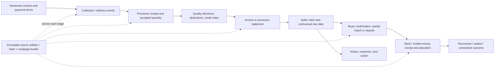

# Terravanta receivables assurance

## Decision

Terravanta's next commercial hypothesis is **receivables assurance for agricultural suppliers**, beginning with dairy cooperatives selling milk to processors. The product should help a cooperative assemble, age, reconcile and pursue a seller-side claim from its existing records, while allowing the processor to confirm, partially accept or dispute each claim. The resulting evidence pack can support a cooperative's collection work or a lender's diligence. It does not make the claim legally valid, compel payment, extend credit, or move money.

This is a narrower and more valuable job than a cooperative payout close, but it is not an uncontested market. DairyCore advertises invoices, receipts, overdue-account chasing and collection-to-M-Pesa member payouts. eDairy advertises collection, quality, payment and DTB-linked financing. ZuriCap describes invoice finance for suppliers to processors and an electronic payable/invoice workflow; SWAFI describes advancing against dairy invoices with processor approval. Mastercard, Heifer and KCB's Farmer Visibility Project is digitizing dairy transactions and enabling payment/financial-service rails. Those are company or program descriptions, not independent proof of adoption or outcomes, but they invalidate a generic “digital records,” “invoice finance,” or “faster farmer payment” positioning. [DairyCore](https://dairycore.co.ke/core/for-cooperatives/), [eDairy](https://edairy.africa/edairy-system/), [ZuriCap](https://zuricapltd.com/about/), [SWAFI](https://www.swafi.co/post/boosting-dairy-production-with-swafi-s-financial-support), [Farmer Visibility Project](https://www.mastercard.com/news/eemea/en/newsroom/press-releases/en/2026/july/heifer-mastercard-and-kcb-launch-digital-payments-initiative-for-dairy-farmers/)

## Current implementation

The repository now contains a manual receivables vertical slice: cooperative claim register and intake UI, processor inbox and response UI, organization-scoped API authorization, due-date aging, itemized assertion lines, receipts and allocations, private PDF/CSV file storage, SHA-256-checked downloads, and a claim ZIP containing JSON/CSV history plus original evidence. A cooperative can also record a budget-owner paid-repeat decision; an approved decision requires a price unit and attached approval artifact. The record is explicitly a cooperative user's attestation, not independent verification of the budget owner's identity.

Roles are server enforced. A processor can read a case only after submission to its registered processor organization; the seller and processor see different read paths. The existing payout close remains unchanged and separate. The current release has no source-system adapters, invoice import/matching engine, self-service processor invite flow, contract CRUD/confirmation UI, automatic retention/deletion job, malware scanner, lender portal or real claim/outcome. No customer or paid repeat is proven.

The upload accepts PDF and UTF-8 CSV only, rejects oversize files, writes to a private local Docker/Render persistent disk or configured private S3-compatible bucket, uses random server-generated keys, and rechecks the stored content hash on read. Render runs one instance with a private disk by default in `render.yaml`. Do not add API instances with local-disk storage. For S3, block public access and use dedicated credentials. Antivirus scanning, expiry/deletion automation, backup restore validation and formal security review remain deployment work. Do not use real financial files until the cooperative authorizes the exact sources and retention/backup plan.

### Commercial edge to test

**Neutral, cross-system proof of a receivable.** Terravanta should not replace collection capture, processor accounts payable, a cooperative MIS, bank/M-Pesa rails, or a lender's underwriting. It should connect evidence already held by different parties—contract terms, delivered and accepted volumes, quality adjustments, invoices/statements, payment advices and actual bank/mobile-money credits—into one claim timeline with explicit source, owner, status, amount and aging. The differentiating work is reconciling across those boundaries and obtaining a counterparty response, not merely putting an invoice in a portal.

The market pain is plausible and has a concrete legal process anchor: Kenya's Milk Sales Contract Regulations require milk-sale contracts with payment terms and provide for monthly payment timing, default interest under the stated formula, and a route for a seller to ask the Kenya Dairy Board to intervene. Terravanta must encode the parties' actual contract and dates; it must not declare that a balance is legally due, calculate a legal claim without reviewed terms, or substitute for counsel or KDB. [Kenya Law, Dairy Industry (Milk Sales Contract) Regulations](https://new.kenyalaw.org/akn/ke/act/ln/2021/20/eng%402022-12-31/source.pdf)

The buyer is not settled. A cooperative is the natural claim owner and source-data holder, but may have little cash while arrears are outstanding. A receivables financier or bank may have stronger budget and urgency, but already originates finance and will demand processor acceptance, assignment rights, anti-fraud controls and dependable recovery data. The processor may pay for fewer disputes and cleaner AP, but has little incentive to buy a tool that mainly strengthens a supplier's claim. Test these three seats separately; do not assume a two-sided marketplace or a lender-funded SaaS contract.

**Candidate outcome offer:** “For each processor settlement period, we assemble a source-linked receivables register showing each cooperative claim, counterparty response, open balance, contractual due date and days overdue, then prepare a reviewed evidence pack for collection or finance diligence; priced per counterparty-period with source onboarding scoped separately.” This is a testable service description, not a promise of faster payment, recovery, financing, or a published price.

### Competitive position

| Player/category | Strong incumbent capability (as publicly described) | What Terravanta must not claim | Possible interface with Terravanta |
| --- | --- | --- | --- |
| DairyCore | Cooperative records, collection, milk sales, invoices/receipts, overdue-account chasing, deductions, batch member payouts, member statements and herd records | A new cooperative MIS, payout ledger, herd system or generic reconciliation dashboard | Import and link its exports; compete only where the seller-to-processor claim remains unresolved across systems |
| eDairy | KDB-collaborative dairy system with scales, farmer identity, milk quality and financial integrations including DTB-linked loans | A better collection or quality-capture network without evidence | Treat scale, analyzer, collection and finance records as evidence sources |
| Mastercard / Heifer / KCB | Farmer transaction visibility, digital profiles, payment enablement and financial-service access through a multi-party program | A new farmer identity or payment rail | Interoperate with consent and lawful access; measure whether digitization leaves claims unmatched |
| ZuriCap / SWAFI and other financiers | Invoice financing and accelerated supplier payment; public descriptions include processor/buyer approval and processor-credit underwriting | A lender, factor, advance product, or novel “get paid early” offer | Supply permissioned, reconciled evidence if a lender confirms it improves diligence cost or risk decisions |
| Terravanta hypothesis | Independent evidence-to-claim graph across seller MIS, processor response, contract, and payment evidence | A proven moat, accepted debt, legal determination, or reduction in arrears | Become a repeatable cross-system claim operations layer with multi-party confirmation and auditable outcomes |

Public product pages establish competitive claims, not comparative benchmarks. Before naming any company as a partner, validate its actual API/export access and customer practices. The whitespace may be smaller than it appears; stop or reposition if the existing buyer MIS, processor portal or financier already performs this exact cross-party job at acceptable cost.

## Why this might become defensible

The potential moat is a **permissioned, counterparty-confirmed receivable evidence graph plus reusable data adapters and operating outcomes**. One cooperative's uploaded spreadsheet is not a moat. A durable system would have to link, with preserved provenance:



Defensibility compounds only when Terravanta can reuse source mappings, identify a discrepancy once and explain it from evidence, capture both parties' response with permission, and measure which claims later settle. Outcomes must never be pooled across customers or used to train external models without legal authority and explicit contractual permissions. The moat depends on counterparties participating, connectors being reusable, trust remaining intact, and operating cost falling; none is established today.

## Product boundary and status semantics

Keep the existing cooperative settlement close as a separate **member-payable** workflow. It compares cooperative collection, processor settlement and member payout exports. It does not establish the processor's debt to the cooperative. New receivables assurance is the **cooperative-receivable** workflow. Never net, relabel or infer one ledger from the other.

Use these statuses as evidence states, not legal conclusions:

| State | Meaning |
| --- | --- |
| `draft` | Cooperative is still assembling an internal claim; not shared externally |
| `asserted` | Seller/cooperative entered an amount and attached its basis |
| `submitted` | Claim package was sent through a recorded channel to the counterparty |
| `counterparty_confirmed` | An authorized counterparty user confirmed the stated amount or an explicit amount in a signed/otherwise auditable response |
| `partially_confirmed` | Counterparty confirms only part of the asserted amount; disputed/unanswered remainder remains separate |
| `disputed` | Counterparty supplied a reason or source for a difference; preserve both positions |
| `partially_paid` | One or more actual cash receipts are allocated, but the claim is not fully settled |
| `paid` | Allocated receipts equal the confirmed/claim balance under the agreed accounting rules and an authorized reviewer closes it |
| `closed` | Case was closed with an explicit reason; closure does not imply payment |

`overdue` is derived only when a reviewed contractual due date exists and has passed. Show **asserted**, **counterparty-confirmed**, **disputed**, **received**, and **remaining** amounts separately. A seller-only upload is not a verified receivable. An age from delivery date is not days past due. If the governing payment term is unclear, show “due date not established.”

## Core architecture redesign

Keep the current FastAPI, PostgreSQL/PostGIS, SQLAlchemy/Alembic, role and organization isolation. Add a dedicated `receivables` bounded context; do not rename `SettlementClose` or overload the current `deliveries` and `buyers` farm records. The operational database can provide a projection for dashboards, but uploaded source artifacts and append-only events remain the provenance spine.

### Domain records

| Entity | Purpose and invariants |
| --- | --- |
| `counterparty_relationships` | Cooperative-owned link to a processor/buyer; party identity and external key are explicit, never guessed from a name |
| `evidence_artifacts` | Private object-store metadata, content hash, source, uploader, media type, retention and sensitivity; no public object URLs |
| `source_mapping_profiles` | Organization-scoped, versioned source schema/field mappings with a human approval state; never silently apply a new mapping to old imports |
| `supply_contracts` | Seller/buyer agreement version, effective period, payment-term snapshot, review/confirmation state and source artifact; activated terms are not silently edited |
| `receivable_cases` | Seller's claim anchor (invoice, processor statement or agreed period), parties, period, currency, asserted amount, due date if human-confirmed, and current evidence status |
| `receivable_case_lines` | Normalized supply, quality-adjustment, deduction and credit-note lines with direction, amount, provenance, evidence locator and applied mapping version |
| `receivable_evidence_links` | Claim-to-artifact edges with role, file/row/page locator, submitting party and actor; evidence never loses its original source reference |
| `counterparty_confirmations` | Append-only buyer response with confirmer identity, explicit amount accepted/disputed, reason and response evidence; only an authorized counterparty session may label it buyer-confirmed |
| `cash_receipts` + `cash_allocations` | Inbound cash observed by the seller, its verification class, source and allocation across one or more cases; no transfer or payout instruction is issued |
| `receivable_case_events` | Append-only submission, follow-up, dispute, confirmation and close history; correction creates a new event/version, not a rewritten audit fact |

Store KES using `NUMERIC`, dates as local accounting dates, event timestamps in UTC, and source artifact hashes. Each tenant-owned row carries `organization_id`; composite foreign keys prevent a case from attaching another tenant's contract or artifact, and counterparty confirmations are bound to the case's declared counterparty and an organization member. Service authorization must still verify the correct user role, case-to-relationship counterparty consistency, data-sharing mandate, object access and every read/write. Database RLS is a production hardening step; frontend role checks alone are never sufficient.

### Derived register and aging

The register is a deterministic projection, never an AI answer:

```text
asserted balance       = seller assertion from claim lines / invoice snapshot
confirmed balance      = latest valid counterparty confirmation, kept separate
reported cash          = seller-attested receipts linked to evidence
confirmed cash         = bank-evidence-reviewed or counterparty-confirmed receipts
open confirmed balance = confirmed balance - eligible allocated receipts
days past due          = max(0, as_of_date - reviewed contractual due date)
```

The register must label aging as “days past reviewed due date” and keep it distinct from a legal conclusion. If only the cooperative asserts the claim or payment date, the interface must preserve that provenance and avoid presenting it as a confirmed amount or independently verified cash receipt. Do not calculate a fee, interest, price adjustment, milk quality deduction, or legal amount from a model. Contract/date calculations must use a versioned, reviewed rule and display the source term. Unknown, conflicting or unsupported terms yield an unresolved due date, not a guessed aging bucket. The Kenyan Regulations are a reason to model payment terms and dispute evidence carefully, not a basis for an automated legal conclusion.

### Evidence ingestion and operations

1. Accept PDF and UTF-8 CSV through case-scoped upload, validate extension/signature or text encoding, size and SHA-256, and store privately. Malware scanning is not integrated; configure an external scanning control before accepting untrusted live uploads.
2. Preserve the raw file and create deterministic normalized rows with source filename, sheet/page/row locator, source reference and mapping-version ID.
3. Any OCR or model extraction creates a draft field with confidence, model/prompt/version and source locator; a human confirms it before it affects a claim.
4. Match only under explainable deterministic keys (processor account/reference, contract, period, invoice number, quantity/value); fuzzy suggestions remain review-only and cannot merge identities or money.
5. Create or update a claim as a new version/event; keep asserted, processor-confirmed, disputed and cash-received positions separate.
6. Produce role-specific exports: cooperative collection pack, counterparty exception response pack, or lender diligence pack. A lender pack is generated only after explicit mandate/consent and never contains private veterinary details by default.

### Implemented API routes

The current router uses fixed role-scoped paths and derives organization scope from the authenticated user's membership; callers cannot select another organization ID:

```text
GET/POST /api/v1/cooperative/receivables/relationships
GET/POST /api/v1/cooperative/receivables/cases
GET      /api/v1/cooperative/receivables/summary
GET      /api/v1/cooperative/receivables/cases/{case_id}
POST     /api/v1/cooperative/receivables/cases/{case_id}/evidence
POST     /api/v1/cooperative/receivables/cases/{case_id}/assert
POST     /api/v1/cooperative/receivables/cases/{case_id}/submit
POST     /api/v1/cooperative/receivables/cases/{case_id}/receipts
POST     /api/v1/cooperative/receivables/cases/{case_id}/allocations
POST     /api/v1/cooperative/receivables/cases/{case_id}/pilot-decisions
GET      /api/v1/processor/receivables/cases[/{case_id}]
POST     /api/v1/processor/receivables/cases/{case_id}/responses
GET      /api/v1/receivables/cases/{case_id}/evidence/{artifact_id}
GET      /api/v1/cooperative/receivables/cases/{case_id}/evidence-export
```

The export is a ZIP with `claim.json`, line/response/receipt/allocation/event CSVs, an evidence manifest with SHA-256, and the linked source files. It is private and requires a cooperative role. The processor can download only evidence linked to a claim submitted to its organization.

Contracts and source import adapters are future work. `due_date_basis=manual_review` records a cooperative review; the API also accepts a contract basis only for an active, counterparty-confirmed contract already in the database. There is not yet an end-user contract management workflow.

The register response returns a structured balance breakdown, aging basis/date, status, source evidence references and verification class. Allocation logic prevents total allocations from exceeding a receipt or seller-asserted claim amount and enforces currency equality. The UI does not enumerate processor organizations: a registered processor ID is supplied through the authorized onboarding handoff. The list API must not expose a lender view to a cooperative by default or vice versa. Do not expose a route to originate a loan, initiate a bank/M-Pesa transfer, send a legal demand automatically, or certify a claim.

## First workflow and acceptance evidence

The first product slice is one retrospective claim, one cooperative, one processor relationship, and one closed/overdue settlement period. Gather, with written authority, the contract/payment-term version, cooperative supply records, processor receipt/acceptance or statement, quality/deduction records, invoice or seller claim, bank/mobile-money credits and correspondence. Pseudonymize member identities where the claim can be demonstrated at aggregate cooperative level.

Measure:

- time and staff roles required to assemble the claim before/with Terravanta;
- share of claimed KES supported by each source class, and gaps by amount and age;
- seller-asserted vs buyer-confirmed vs disputed vs received amounts;
- time to prepare and send a complete claim package, and counterparty response time;
- later accepted, partly accepted, rejected or paid outcomes, with dates and independent evidence;
- lender diligence time and a real buyer budget/paid-repeat decision, if a financier is involved;
- setup/support minutes and cost per counterparty-period.

The pass condition is not “high automatic match rate.” Require the cooperative to validate provenance, a processor or other authorized counterparty to respond to at least one claim, a named budget owner to choose a priced repeat service, and acceptable delivery economics. If no processor response or paid repeat occurs, this has not proved a moat. If the receivable is undisputed but the processor lacks liquidity, evidence tooling alone cannot cure the arrears; the solution may require a lender or public intervention partner.

## Delivery sequence

1. **Evidence schema:** additive tenant-scoped contract, artifact, claim, confirmation, receipt-allocation and event records; keep member payable closes intact.
2. **Manual claim register:** seller assertion, explicit due-date basis, aging, provenance and CSV/PDF export; no AI authority or money movement.
3. **Counterparty response:** invite-based authorized processor workspace, partial acceptance/dispute, reason codes and immutable response history.
4. **First adapter:** only after receiving a real authorized sample from a named MIS/processor/payment source; version mapping profiles and idempotency keys.
5. **Finance diligence view:** only with a lender design partner and explicit seller mandate, show confirmed receivable, unpaid allocation and dispute state; lender retains credit decision and funds.
6. **Network expansion:** replicate a proven contract/event/evidence schema across additional cooperatives and processors. Do not build a general agricultural payments marketplace before a repeated paid job exists.

## Risks and stop conditions

- **Not a new pain:** if an incumbent already produces cross-party, source-linked, buyer-confirmed aging and claim packs, do not add a second register.
- **No payment ability:** if the processor is insolvent, document preparation cannot create liquidity. Do not market faster payment as an outcome without a finance partner or measured causal mechanism.
- **No counterparty data:** if processors refuse confirmation or export access, the product remains a seller-side assertion database with weak financing value.
- **Cooperative has no budget:** test lender/processor sponsorship, but only from an expressed budget and procurement path. Do not count introductions or stated interest as revenue.
- **Unprofitable integration:** measure file-mapping, dispute-support and field-service hours; pause a custom adapter that cannot be reused or funded.
- **Rights and privacy:** obtain legal review of confidentiality, lawful basis, controller/processor responsibilities, member authorization, lender sharing, retention and assignment before importing live financial or personal data.
- **Fraud/false claims:** preserve raw evidence, separate source classes and confirmation authority, log changes, require dual review for exports and corrections, and prohibit AI adjudication.

## Evidence references

- [DairyCore for cooperatives](https://dairycore.co.ke/core/for-cooperatives/)
- [eDairy System](https://edairy.africa/edairy-system/)
- [Mastercard, Heifer and KCB Farmer Visibility Project announcement, 28 July 2026](https://www.mastercard.com/news/eemea/en/newsroom/press-releases/en/2026/july/heifer-mastercard-and-kcb-launch-digital-payments-initiative-for-dairy-farmers/)
- [ZuriCap company description](https://zuricapltd.com/about/)
- [ZuriCap supplier invoice and buyer-approval workflow](https://zuricapltd.com/)
- [SWAFI dairy invoice-finance thesis](https://www.swafi.co/post/boosting-dairy-production-with-swafi-s-financial-support)
- [Kenya Law: Dairy Industry (Milk Sales Contract) Regulations 2021](https://new.kenyalaw.org/akn/ke/act/ln/2021/20/eng%402022-12-31/source.pdf)
