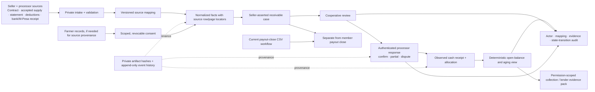

# Terravanta project proposal

## Receivables assurance across agricultural supply chains

**Version:** 0.2 · **Date:** 18 November 2026 · **Status:** Draft for partner and funder discussion
**Initial market:** Kenyan dairy cooperatives and processors
**Important:** All records currently shown in the demonstration are synthetic. No cooperative has validated or purchased this service.

## 1. Executive summary

Terravanta proposes to validate a system-agnostic receivables assurance service for dairy cooperatives. For each processor settlement period, it will assemble the cooperative’s seller-side claim from contract terms, delivery/acceptance records, processor statements, quality adjustments and actual cash receipts; keep seller assertion, buyer confirmation, disputed value and received cash separate; age any remaining balance against a reviewed contractual due date; and prepare a source-linked claim or lender-diligence pack. It will not decide legal entitlement, originate credit, or initiate payments.

The commercial thesis is that a cooperative, processor or finance institution may pay to reduce the recurring labor and uncertainty of proving, responding to, or diligencing a processor receivable. This remains a hypothesis. DairyCore and eDairy already advertise broad dairy MIS capabilities; ZuriCap and SWAFI describe agricultural invoice finance; and Mastercard/Heifer/KCB are digitizing dairy transactions and enabling payment/finance. Terravanta cannot win on records, reconciliation, or faster payment as generic categories. Its candidate edge is a neutral, cross-system evidence graph and authenticated counterparty response that existing systems do not already deliver for a specific buyer.

The repository contains farm, veterinary, crop, feed, production, delivery and consent workflows plus a member payout-close CSV workflow. An additive receivables schema foundation is being introduced for counterparties, versioned source mappings/contracts, private evidence artifacts, seller claim lines/cases, buyer confirmations, inbound cash receipts/allocations and case events. This is not yet a receivables application workflow: no claim API, evidence-pack export, processor connector, counterparty portal, real-cooperative validation or paid customer exists. All demo records are synthetic. Production retention, file security and support controls require completion before live member or financial data is handled.

This proposal requests a **phased validation project**, not an unbounded agricultural platform rollout. First interview cooperative claims/finance, processor accounts payable and a receivables financier separately. If a specific gap is proven, use one authorized, retrospective processor-period claim to measure assembly effort, evidence coverage, buyer response, disputed value and financing usefulness. Proceed to a paid repeat only if one named budget owner selects it and delivery economics are viable.

## 2. Project purpose and decision requested

**Purpose:** Determine whether cross-party receivables proof and claim operations are a recurring, costly job, whether the buyer values a neutral evidence workflow, and whether a multi-party-confirmed record can be delivered with proper authority, privacy and sustainable service cost.

**Decision requested from a pilot sponsor:**

1. Nominate the cooperative owner of processor receivables and the finance/records staff who assemble or pursue a claim.
2. Allow an initial workflow interview without member-level data; separately introduce a processor AP contact and a lender/receivables-finance operations contact.
3. If a specific gap exists, agree authority, confidentiality, source scope, baseline, retention/deletion plan, decision date and paid-pilot route before any files move.
4. Review a one-period claim pack with the cooperative and seek a recorded processor response; ask a lender whether the confirmed evidence changes diligence effort or eligibility.
5. Make a priced repeat decision with the budget owner. Stop if the incumbent already solves the job or the processor will not respond and no buyer values a seller-side pack.

There is no amount requested in this draft. A credible budget requires the pilot duration, partner requirements, approved deployment environment, staff effort and secure data-handling costs to be known first.

## 3. Market problem and entry wedge

Kenya’s Milk Sales Contract Regulations require written seller/buyer terms that include payment, quality, notices and dispute resolution. They set a payment timing reference and describe default interest and KDB intervention. This makes contract-linked evidence operationally relevant, but Terravanta must use the actual contract and legal review; it must not label an asserted balance legally due or calculate a legal demand automatically. [Kenya Law regulations](https://new.kenyalaw.org/akn/ke/act/ln/2021/20/eng%402022-12-31/source.pdf)

The customer problem to test is: **After the cooperative and processor systems record supply and payments, does anyone still spend material time proving the cooperative's outstanding processor receivable, resolving the difference with the processor, and preparing evidence for collection or finance?** Need to distinguish lack of liquidity from record mismatch. A product may improve proof and follow-up; only a counterparty with funds, a financing partner or an institutional intervention can change when cash arrives.

The competitive bar includes farm/co-op software, payments and invoice finance. DairyCore markets collection-to-payout, herd records, invoices and overdue-account chasing; eDairy advertises collection equipment, milk quality, payment integrations and DTB-linked credit. The Farmer Visibility Project groups Mastercard, Heifer and KCB around digital dairy transactions and financial-service access. ZuriCap describes purchased receivables and electronic payables/invoice submission; SWAFI describes processor-approved dairy invoice finance. Public pages show their stated scope, not independent efficacy or a Terravanta partnership. Terravanta should not claim those jobs are open without asking the customer to demonstrate their current tool and unresolved exceptions. [DairyCore](https://dairycore.co.ke/core/for-cooperatives/), [eDairy](https://edairy.africa/edairy-system/), [Farmer Visibility Project](https://www.mastercard.com/news/eemea/en/newsroom/press-releases/en/2026/july/heifer-mastercard-and-kcb-launch-digital-payments-initiative-for-dairy-farmers/), [ZuriCap](https://zuricapltd.com/about/), [SWAFI](https://www.swafi.co/post/boosting-dairy-production-with-swafi-s-financial-support/)

### Initial ideal customer profile

Start with one cooperative/processor relationship where the cooperative:

- has an overdue or disputed processor claim with a specific settlement period and a named cooperative claim owner;
- can identify source evidence held across at least two parties/systems, rather than merely re-entering one system's data;
- can identify a buyer/budget owner and a written route to a repeat paid service;
- is willing to seek an authorized processor response to the test claim;
- can lawfully share a retrospective, minimized data sample without changing a live ledger or payment flow.

If the current system already assembles, ages and resolves processor receivables with acceptable staff effort, Terravanta should not sell a duplicate workflow to that customer.

## 4. Proposed service and offer

### Terravanta Receivables Assurance

For every agreed settlement period, Terravanta’s proposed managed service will:

1. Receive authorized contract, supply/acceptance, invoice or statement, quality-adjustment and cash-receipt evidence through a private channel.
2. Apply versioned mappings and retain the original file hash plus each normalized row/page locator.
3. Build the cooperative's claim as an **assertion** and separately show any authorized processor-confirmed, disputed, paid and open amounts.
4. Calculate aging only against a human-reviewed due date linked to the contract term; unknown terms remain unknown.
5. Route a claim to an authorized counterparty for a recorded acceptance, partial acceptance, dispute or information request.
6. Allocate documented inbound cash receipts to the claim; produce a reviewed collection or lender diligence pack under explicit sharing permission.
7. Record staff effort, evidence gaps, response time and eventual outcome to price a repeat service.

**Offer to test:** “For each processor settlement period, we assemble a source-linked receivables register showing each cooperative claim, counterparty response, open balance, contractual due date and days overdue, then prepare a reviewed evidence pack for collection or finance diligence; priced per counterparty-period with source onboarding scoped separately.” This is a service hypothesis, not a published price, promise of faster payment, recovery, financing, or return.

### Work retained by the cooperative

The cooperative owns and attests its claim and its records. The processor owns its response. A named user reviews due-date terms, evidence links, cash allocation and exports. A lender makes its own underwriting and financing decision. Terravanta will not determine legal entitlement, certify a debt from seller uploads, modify either party's ledger, release or route funds, originate loans, send automatic legal demands, or override a reviewer.

## 5. Product scope

### First paid-job scope (after validation)

- One processor-period claim, one cooperative and one counterparty relationship.
- Contract version/payment term, cooperative supply evidence, buyer acceptance/statement, quality/deduction basis and actual receipts where available.
- Deterministic source mapping and matching; no fuzzy identity merge or model-generated financial facts.
- Seller-asserted, buyer-confirmed, disputed and received amounts shown separately with claim age based on reviewed due date.
- Evidence pack with immutable source hashes and row/page references, redacted for the specific recipient.
- One counterparty response step and a paid-repeat decision; setup and support labor measured as delivery cost.

### Supporting product layer

Farmers can keep farm, animal, health, crop, feed, production and delivery records in a private farm workspace. Veterinarians can review assigned clinical records and verify their own findings. A cooperative sees only the expressly shared delivery-summary scope; private veterinary records are excluded by default. This connected record can improve provenance and farmer utility, but the receivables workflow should not depend on farmers re-entering a delivery already captured by the cooperative or processor.

### Out of scope for the first commercial pilot

- Replacing an existing cooperative MIS or point-of-collection workflow.
- Any named connector until a customer-authorized source export and repeat demand exist.
- Editing source ledgers, initiating payouts, originating advances or sending automatic legal demands.
- AI deciding a financial fact, adjudicating a claim, confirming a contract term or approving an evidence pack.
- AI diagnosis, treatment or food-safety certification.
- Lending, insurance, buyer marketplaces or sale of farm data.
- Any claim of reduced fraud, payment error, losses or labor without a measured baseline.

## 6. Product readiness: implemented versus proposed

| Area | Implemented in this repository | Still required for a real pilot |
| --- | --- | --- |
| Member payout close | Three CSV imports, deterministic volume/amount checks, evidence-linked exceptions, reviewer notes, named approval and member statement-pack export | This is cooperative-to-member payable reconciliation; it does not prove the processor owes the cooperative |
| Receivables assurance | Additive SQLAlchemy/Alembic foundation for counterparty relationships, mapping/contract versions, private evidence metadata, seller claim lines/cases, buyer confirmations, cash receipts/allocations and case events | API, private object-storage integration, evidence upload/review, due-date rules, buyer portal, aging register, exports and a real confirmed claim are not implemented |
| Source systems | Existing normalized CSV contracts for intake reconciliation and member payout close | No named receivable, processor, MIS, bank or mobile-money adapter |
| Statements and money | Member payout-close CSV is available after cooperative approval | No processor claim evidence pack, incoming receipt allocation workflow, ledger write-back, payment rail, loan, or payment authorization |
| Farm and veterinary | Farm, plots, animals, health events, verification, production, feed, resource cycle, delivery and consent workflows | Real account configuration, field workflow validation and operational support |
| AI | Backend provider abstraction and opt-in veterinary draft/document extraction paths | Live NVIDIA account validation, approved references, veterinarian evaluation and data-term review; AI is not needed for the close |
| Data protection and operations | Server-enforced role and consent checks, audit trail, synthetic data off by default | Dedicated pilot environment, agreed retention/deletion process, tested backups, monitoring, incident response and real-data access review |
| Offline use | Single-browser offline POST queue | Encryption, broader offline coverage, conflict handling and multi-device synchronization |

All included farm and cooperative demo entities are synthetic. A public deployment or successful build does not prove market demand, production readiness or a real customer relationship.

## 7. Delivery architecture

Receivables assurance is a distinct bounded context from the existing member payable close. It keeps immutable source artifacts and append-only events separate from normalized assertions, buyer confirmations and observed cash. AI is not part of the first claim workflow and cannot confirm financial facts or contract terms.

The current stack is Next.js/TypeScript, FastAPI, SQLAlchemy/Alembic and PostgreSQL/PostGIS, with Supabase Auth. The migration and ORM are only the database foundation; the receivable API and client are future implementation. The existing settlement service remains intact and addresses downstream member payouts. Before live financial data is used, enforce same-tenant composite links, check service authorization for seller and counterparty roles, integrate private object storage and malware scanning, implement retention/deletion, and review backups/access. Source files and amounts may remain confidential or re-identifiable after pseudonymization.

For Kenyan data protection, confirm Terravanta’s and the cooperative’s controller/processor roles, lawful basis, notice, retention and registration obligations with qualified counsel or the ODPC before the pilot. The ODPC describes controller/processor registration and rights obligations in its current guidance and FAQs. [ODPC guidance on registration](https://www.odpc.go.ke/faqs/), [ODPC data-protection framework](https://odpc.go.ke/data-protection-laws-kenya/)

## 8. Pilot plan and stage gates

The following is an indicative 90-day learning plan **after an organization agrees to discovery**. Access to a cooperative, processor, lender and authorized data is not yet secured, so calendar dates are conditional.

| Stage | Indicative timing | Work | Exit gate |
| --- | --- | --- | --- |
| 0. Three-seat discovery | Weeks 1–2 | Interview cooperative claims/finance, processor AP and lender/financier operations. Map one real overdue/disputed processor claim, current MIS/rails, evidence holders, existing chase/factoring workflow, budget owners and procurement. No files needed. | One repeated cross-system task is evidenced and the proposed buyer sees a material gap not covered by its incumbent. |
| 1. Baseline and authorization | Weeks 2–4 | Agree measures for active minutes, claim preparation time, source coverage, disputed/confirmed/received KES, response time and service effort. Sign authority, confidentiality, data-use and retention/deletion plan. | Written data authority, named owner and secure environment exist; no live payment/ledger changes. |
| 2. Retrospective claim reconstruction | Weeks 4–7 | Use minimized/pseudonymized sources for one processor-period claim; record mapping and source locators; have cooperative review the assertion and invite an authorized processor response. | Provenance is validated; confirmed/disputed gaps are explicit; setup effort is measured; at least one counterparty response is obtained or the lender/cooperative explains why the seller-only file is useful. |
| 3. Commercial decision | Weeks 7–9 | Present the before/after assembly effort, evidence coverage, processor response, claim status and cost-to-serve separately to each budget owner. Agree their improvement threshold and repeat scope. | A named buyer chooses a priced repeat service; positive feedback or lender interest alone does not pass. |
| 4. Paid repeat and replication decision | Weeks 9–13+ | Run the next period under contract, add only a reusable authorized mapping, record eventual receipt/settlement and service cost. | Paid renewal, acceptable service margin, explicit data authority and credible route to a second counterparty relationship. |

The first cooperative candidate, interview guide, baseline worksheet and file-safety checklist are in the [cooperative pilot kit](COOPERATIVE_PILOT_KIT.md). The shortlist is for discovery only; none is a Terravanta partner or customer.

## 9. Evidence and success measures

Capture the baseline before using Terravanta. Keep elapsed claim-assembly/response time separate from active staff minutes and cash timing. Do not attribute eventual payment to the tool without a comparison design; do not convert hours to KES unless the customer supplies the cost basis.

**Buyer value:** claim assembly time; staff minutes by role; share of asserted amount supported by each evidence class; seller asserted versus buyer confirmed/disputed versus actual receipts; elapsed counterparty response; open balance and days past a reviewed due date; repeat dispute/rework; and existing spend if shared.

**Product quality:** import and mapping failures; source-link coverage; false matches found in review; confirmed/disputed amount consistency; receipt-allocation errors; missing due-date basis; export corrections; audit completeness; system availability; and service/support hours per processor-period.

**Commercial proof:** separate named budget owners and procurement path; written threshold set before the test; processor response to claim evidence; paid repeat decision; actual delivery cost; and a second counterpart relationship using the same mapping/operating playbook. Do not call this PMF after one demo, free test, lender introduction or automatic match rate.

**Farmer and data trust:** clear understanding of what the cooperative can see; consent scope and revocation; access review; deletion/retention completion; and zero unresolved consent-scope incidents. Any material consent misunderstanding pauses expansion.

## 10. Revenue model and scaling thesis

### Initial revenue hypothesis

1. Test a fixed fee per counterparty-period claim file / reviewed evidence pack; avoid a percentage of funds recovered or farmer data sales.
2. Charge separately for customer-specific mapping and onboarding until reuse makes it unnecessary.
3. Move to a recurring organization/volume service contract only after repeated usage, a budget owner and delivery-cost evidence.
4. Test a lender-sponsored evidence workflow only if a lender says which source/confirmation gaps it will pay to remove and signs data-access terms.
5. Keep farm/vet recordkeeping sponsored or free during validation unless direct willingness to pay is demonstrated.

For each case, measure revenue minus mapping labor, counterparty follow-up, evidence review, onboarding, field support, infrastructure, storage, security and third-party costs. A recurring service is viable only if the paying buyer can name the budget and measured benefit, and margin improves as mappings and claim operations are reused. Do not quote a price before discovery.

### Scale path

- **One relationship, one claim:** prove reconstruction and actual counterparty response manually from authorized exports.
- **Repeat the same relationship:** version terms and mappings, automate deterministic evidence links, aging and reminder queues.
- **Second cooperative/processor relationship:** test onboarding reuse and whether the same canonical evidence/response protocol works across systems.
- **One adapter at a time:** build a named MIS, processor or cash-source connector only after authorized samples and paid repeat demand.
- **Expand the farm record layer:** support consented delivery provenance and farmer utility; add veterinary, feed and crop workflows where active customers request them and use can be measured.
- **Add AI selectively:** test model-assisted column mapping or exception summaries against deterministic output, with human acceptance, logs and external-processing permission. Keep money decisions and clinical judgment with qualified people.

### Potential moat—not yet established

The moat could come from a permissioned and auditable evidence graph linking contracts, accepted supply, claims, authenticated buyer responses, cash allocations and outcomes, alongside reusable mappings and reliable claim operations. The current codebase has no live receivables API/UI, named connector, counterparty confirmation or validated outcome data; the schema foundation alone creates no moat. Customer data is not a moat by default and must not be pooled or used for external model training without valid permission.

## 11. Team, budget and operating needs

The initial project needs clear owners for:

- cooperative claims discovery, processor AP engagement, lender discovery and a named budget decision;
- backend engineering for private evidence intake, source mappings, contract/claim events and tenant isolation;
- cooperative and processor operations for claim review and counterparty response;
- security, data protection, contracts and retention/deletion review;
- customer operations during claim assembly, processor response and result measurement.

Cost the pilot only after the partner scope is known. The budget should separate engineering/product time, secure hosting and backups, approved data transfer/storage, field travel and training, customer support/reconciliation labor, privacy/legal review and contingency. Record founder labor as a cost; do not hide manual work in an apparent software margin.

## 12. Risks and controls

| Risk | Why it matters | Control / stop condition |
| --- | --- | --- |
| Incumbent already proves and ages the processor receivable | Terravanta would be a duplicate claims ledger | Inspect the actual buyer and processor workflows; stop where a mature MIS already does the job adequately. |
| Seller assertion mistaken for debt | A false claim may harm supplier, processor or lender | Label every amount by source and party; only an authorized counterparty response is buyer-confirmed; counsel owns legal interpretation. |
| Processor cannot pay | Evidence cannot fix insolvency or liquidity shortfall | Separate record-mismatch from inability-to-pay; involve finance only with a partner and paid budget; never promise payment timing. |
| No counterparty response or source access | A seller-side claim file has weak evidentiary/finance value | Require authorization and seek a real processor response before calling the pilot a success. |
| No budget owner or procurement path | Usage interest may never become revenue | Name the buyer and require a paid-repeat decision date before broad onboarding. |
| Dirty or incompatible exports | Matching results can be wrong or require unsustainable manual cleanup | Version mappings, retain source row/page locators, audit samples and price support labor. |
| Cross-tenant artifact or claim access | Confidential commercial and member records could leak | Composite tenant-scoped FKs plus server-side organization/counterparty checks, private storage, audit and security review. |
| Member data exposure | Pseudonymised amounts/references may still identify people or reveal sensitive business data | Written authorization, least privilege, isolated environment, approved transfer, retention/deletion plan and privacy review before import. |
| Service requires founder-led data cleanup | Growth could be unprofitable | Track setup and support hours per customer/period; stop custom work that does not become reusable or get paid. |
| Farmer rejects consent or sees unclear value | Trust damage and weak record quality | Explain scoped sharing in simple language, allow revocation, keep veterinary details private, pause if comprehension is poor. |
| AI or clinical overreach | Financial or health harm | Keep AI optional and draft-only; no close approvals, medication or diagnosis; require professional review. |
| Operational outage or data loss | A claim/follow-up deadline may matter to a supplier | Test backup/restore, incident response, monitoring and recovery before live data or paid claim work. |

## 13. Assumptions and open questions

- A recurring cross-system claim assembly/dispute job remains after the incumbent MIS, processor portal and finance systems are used.
- The cooperative can lawfully authorize source evidence and a processor can be invited to respond.
- Contractual due dates and actual receipts can be mapped without guessing legal terms or allocating cash twice.
- Cooperative, processor or lender has an identifiable budget/procurement path for this job.
- At least one buyer will pay for a repeat, not only request free claims software or credit introductions.
- A source-linked claim pack measurably reduces preparation/diligence effort and can be delivered with sustainable support cost.
- The lender sees incremental evidence value rather than an alternative way to originate the same invoice finance it already offers.
- Farmers benefit from a consented record layer and do not have to duplicate collection entries.

Each assumption requires direct evidence. If any first four fail for several suitable candidates, change the wedge or buyer before adding features.

## 14. Recommendation

Proceed with a narrow three-seat discovery and retrospective receivable reconstruction. Do not market Terravanta as a payment rail, lender, cooperative MIS, legal debt-certification service or proven moat. Test whether one cooperative needs a source-linked claim file, whether a processor will confirm/dispute it, and whether a cooperative/processor/lender budget owner will pay to repeat it. If these conditions fail, keep the current payout close as a supporting feature and change the wedge before adding broad AI or more farmer modules.

The next concrete action is to secure separate discovery conversations with one cooperative claims/finance owner, one processor AP owner and one lender or invoice-finance operations owner. No member data is needed for these conversations. The [pilot kit](COOPERATIVE_PILOT_KIT.md) contains discovery preparation; the [receivables assurance contract](RECEIVABLES_ASSURANCE.md) defines the product boundary, data model, status semantics and pilot gates.

## References and related project documents

- [Kenya Ministry of Agriculture and Livestock Development: 2024 milk production costs and profitability report announcement](https://kilimo.go.ke/launch-of-the-2024-study-report-on-milk-production-costs-and-profitability/)
- [SNV: digitalization at Mau Dairy Farmers Cooperative](https://www.snv.org/update/digitization-a-game-changer-for-dairy-cooperatives-in-kenya)
- [DairyCore cooperative product](https://dairycore.co.ke/core/for-cooperatives/)
- [eDairy System](https://edairy.africa/edairy-system/)
- [Mastercard/Heifer/KCB Farmer Visibility Project](https://www.mastercard.com/news/eemea/en/newsroom/press-releases/en/2026/july/heifer-mastercard-and-kcb-launch-digital-payments-initiative-for-dairy-farmers/)
- [ZuriCap invoice finance and receivables](https://zuricapltd.com/about/)
- [SWAFI dairy invoice-finance thesis](https://www.swafi.co/post/boosting-dairy-production-with-swafi-s-financial-support)
- [Kenya Law: Dairy Industry (Milk Sales Contract) Regulations](https://new.kenyalaw.org/akn/ke/act/ln/2021/20/eng%402022-12-31/source.pdf)
- [Office of the Data Protection Commissioner: FAQs and registration guidance](https://www.odpc.go.ke/faqs/)
- [Office of the Data Protection Commissioner: Kenya data-protection framework](https://odpc.go.ke/data-protection-laws-kenya/)
- [Terravanta market wedge and PMF plan](GO_TO_MARKET.md)
- [Receivables assurance architecture and validation](RECEIVABLES_ASSURANCE.md)
- [Cooperative settlement pilot kit](COOPERATIVE_PILOT_KIT.md)
- [Settlement-close contract and technical limits](SETTLEMENT_CLOSE.md)
- [Implemented product scope and roadmap](ROADMAP.md)
