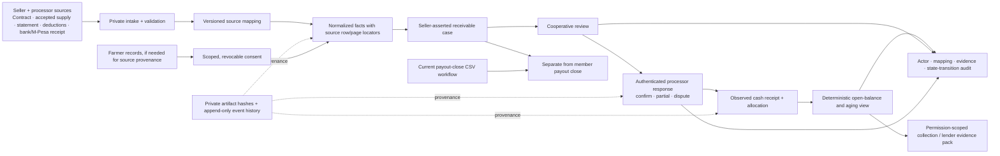

# Terravanta project proposal

## The processor receivables close for agricultural suppliers

**Version:** 0.3 · **Date:** 18 November 2026 · **Status:** Pilot proposal; commercial hypothesis unvalidated
**Initial market:** Kenyan dairy cooperatives and processors
**Evidence boundary:** Demo records are synthetic. No cooperative has authorized a real claim, no processor response has been recorded, and no buyer has purchased a repeat close.

## 1. Executive summary

Terravanta is being repositioned as a **processor-receivables close service** for agricultural suppliers, starting with dairy cooperatives. Each close turns authorized contract, supply, acceptance, adjustment, invoice/statement and cash evidence into a reviewed register that says what the cooperative asserts is owed, what the processor confirms or disputes, what has actually been received, and what remains open against a reviewed due date. Terravanta prepares the follow-up and evidence work product; cooperative staff retain claim approval and escalation decisions, processors own their responses, and lenders own credit decisions.

The customer buys a completed, review-ready close and claim-operation workflow, not another dashboard or AI copilot. This is a hypothesis about recurring labor and accountability, not a claim that Terravanta can make an insolvent or cash-constrained processor pay. It must first distinguish evidence mismatch, processor dispute, and acknowledged-but-unpaid arrears. Existing dairy MIS providers already advertise collection, quality, invoices, member payout and overdue-account workflows; invoice-finance providers already offer early payment. The only credible entry point is the cross-system exception that those tools do not resolve for a specific customer: source-linked proof, a recorded counterparty position, and a usable open-receivable record.

The repository now has a working manual receivables vertical slice: cooperative claim register, private evidence uploads, itemized claim lines, processor response workflow, reviewed-date aging, receipt allocation, evidence export, and a recorded paid-repeat decision. It is not an automatic close: no MIS/processor/bank adapter or source-file reconciliation engine exists, and processor accounts are provisioned through an operator workflow. All demo records remain synthetic. Security operations, data retention, malware scanning, backup/restore and live-data authorization must be reviewed before a real claim is imported.

This proposal requests a **bounded commercial pilot**, not an unbounded agricultural platform rollout: validate one cooperative–processor relationship, reconstruct one authorized retrospective claim, obtain and record the processor’s response, measure current and Terravanta staff effort, then ask the actual budget owner to buy the next close. Proceed only if the incumbent leaves a material gap, the evidence trail is trusted, the repeat has a named buyer and price unit, and the service can be delivered at viable cost.

## 2. Project purpose and decision requested

**Purpose:** Determine whether producing and working a processor receivables close is a recurring service worth buying, whether Terravanta can complete the evidence and exception work with less repeated effort than the current process, and whether a processor response makes the resulting record useful beyond the cooperative.

**Decision requested from a pilot sponsor:**

1. Nominate the cooperative finance/claims owner and the staff who assemble, check, chase or finance processor receivables today.
2. Walk through a recent close using the cooperative’s real system and exceptions; introduce the processor AP reviewer and, separately, a lender operations contact.
3. Agree the baseline, data authority, minimized source scope, transfer method, retention/deletion plan and success threshold before files move.
4. Reconstruct one completed or overdue processor-period claim; have the cooperative approve its assertion and invite the authorized processor to confirm, partly confirm, dispute or request information.
5. Present the measured work and ask the budget owner to approve a priced repeat. Stop or reposition if the incumbent already performs this job or the customer will not pay for it.

No grant or implementation amount is requested in this draft. A paid pilot quote should follow discovery and state the processor-period scope, source onboarding, review labor, security controls and service-level boundaries. The commercial test is whether the customer pays for the next close, not whether it likes the prototype.

## 3. Market problem and entry wedge

Kenya’s Milk Sales Contract Regulations require written seller/buyer terms that include payment, quality, notices and dispute resolution. They set a payment timing reference and describe default interest and KDB intervention. This makes contract-linked evidence operationally relevant, but Terravanta must use the actual contract and legal review; it must not label an asserted balance legally due or calculate a legal demand automatically. [Kenya Law regulations](https://new.kenyalaw.org/akn/ke/act/ln/2021/20/eng%402022-12-31/source.pdf)

The customer problem to test is: **After the cooperative and processor systems record supply and payments, does anyone still spend material time proving the cooperative's outstanding processor receivable, resolving the difference with the processor, and preparing evidence for collection or finance?** Need to distinguish lack of liquidity from record mismatch. A product may improve proof and follow-up; only a counterparty with funds, a financing partner or an institutional intervention can change when cash arrives.

The competitive bar includes farm/co-op software, payments and invoice finance. DairyCore markets collection-to-payout, herd records, invoices and overdue-account chasing; eDairy advertises collection equipment, milk quality, payment integrations and DTB-linked credit. The Farmer Visibility Project groups Mastercard, Heifer and KCB around digital dairy transactions and financial-service access. ZuriCap describes purchased receivables and electronic payables/invoice submission; SWAFI describes processor-approved dairy invoice finance. Public pages show their stated scope, not independent efficacy or a Terravanta partnership. Terravanta should not claim those jobs are open without asking the customer to demonstrate their current tool and unresolved exceptions. [DairyCore](https://dairycore.co.ke/core/for-cooperatives/), [eDairy](https://edairy.africa/edairy-system/), [Farmer Visibility Project](https://www.mastercard.com/news/eemea/en/newsroom/press-releases/en/2026/july/heifer-mastercard-and-kcb-launch-digital-payments-initiative-for-dairy-farmers/), [ZuriCap](https://zuricapltd.com/about/), [SWAFI](https://www.swafi.co/post/boosting-dairy-production-with-swafi-s-financial-support/)

### Initial ideal customer profile

Start with one cooperative/processor relationship where the cooperative:

- has an overdue or disputed processor claim with a specific settlement period and a named cooperative claim owner;
- can identify source evidence held across at least two parties/systems, rather than merely re-entering one system's data;
- can identify a buyer/budget owner and a written route to a repeat paid service;
- is willing to seek an authorized processor response to the test claim;
- can lawfully share a retrospective, minimized data sample without changing a live ledger or payment flow.

If the current system already assembles, ages and resolves processor receivables with acceptable staff effort, Terravanta should not sell a duplicate workflow to that customer.

### Buyer, user and beneficiary hypothesis

| Seat | Likely organization / role | Job in the first close | What must be verified |
| --- | --- | --- | --- |
| Primary buyer hypothesis | Cooperative general manager, finance lead or board-authorized budget owner | Funds the recurring close service because their staff must assemble, defend and follow up on the cooperative's receivable | A real budget line, procurement route, claims frequency and willingness to pay for a repeat close |
| Daily user | Cooperative accountant, finance officer or claims/records staff | Supplies source files, reviews the asserted claim, resolves exceptions and approves the evidence pack | Current labor, rework, tools already used and who has authority to submit a claim |
| Counterparty reviewer | Processor accounts-payable or supplier-finance team | Confirms, partially accepts, disputes or requests information on the cooperative's claim | Whether the processor will participate and whether this reduces its own exception work |
| Possible second buyer | Receivables lender, bank or invoice-finance operations team | Uses an authorized, processor-responded evidence pack for diligence | Whether it pays for evidence preparation and what confirmed facts change its diligence—not just its credit decision |
| Beneficiary | Cooperative members / suppliers | Gain a clearer claim status and evidence trail; may benefit if the cooperative or a financier acts | Member value and data-sharing expectations; do not promise earlier payment |

The first commercial conversation should start with the cooperative because it owns the claim and source authority. The lender may have more liquidity to deploy but is not the primary buyer until it names a budget and signs for a paid workflow. Processors may have lower incentive to buy a supplier-side claim system; test AP value independently. This is a buyer hypothesis, not a market fact.

## 4. Proposed service and offer

### Terravanta Processor Receivables Close

For each contracted cooperative–processor period, Terravanta’s service is intended to:

1. Receive authorized contract, supply/acceptance, invoice or statement, quality-adjustment and cash-receipt evidence through a private channel.
2. Apply versioned mappings and retain the original file hash plus each normalized row/page locator.
3. Build the cooperative's claim as an **assertion** and separately show any authorized processor-confirmed, disputed, paid and open amounts.
4. Calculate aging only against a human-reviewed due date linked to the contract term; unknown terms remain unknown.
5. Route a claim to an authorized counterparty for a recorded acceptance, partial acceptance, dispute or information request.
6. Allocate documented inbound cash receipts to the claim; produce a reviewed collection or lender diligence pack under explicit sharing permission.
7. Deliver the completed register, exception queue and evidence pack to an authorized cooperative reviewer, while recording effort, evidence gaps, processor response and eventual outcome.

**Offer to test:** “We close your processor receivables every settlement period: we reconcile the authorized supply, acceptance, adjustment and cash evidence into a reviewed register of confirmed, disputed, paid and aging balances, then prepare the claim and follow-up pack for a fixed fee per processor-period, with source onboarding scoped separately.” This is a service hypothesis, not a published price or a promise of faster payment, recovery, financing, or return. The MVP still requires staff to map sources and review exceptions; unattended automation is a later product target, not a current capability.

### Work retained by the cooperative

The cooperative owns and attests its claim and records; the processor owns its response. Named users review contractual due-date terms, evidence links, cash allocations and the final claim pack. The system performs repeatable evidence preparation and case administration; it does not make a legal determination or bind either party. Terravanta will not modify source ledgers, release or route funds, originate loans, send automatic legal demands, or override a reviewer. A lender retains every underwriting and funding decision.

## 5. Product scope

### First paid-job scope (after validation)

- One cooperative–processor relationship and a defined settlement-period receivables close; use one retrospective claim first, then price the repeat close.
- Contract version/payment term, cooperative supply evidence, buyer acceptance/statement, quality/deduction basis and actual receipts where available.
- Deterministic source mapping and matching; no fuzzy identity merge or model-generated financial facts.
- Seller-asserted, buyer-confirmed, disputed and received amounts shown separately with claim age based on reviewed due date.
- Evidence pack with immutable source hashes and row/page references, redacted for the specific recipient.
- A processor response workflow, cooperative approval, receipt allocation and paid-repeat decision; setup and support labor measured as delivery cost.

### Supporting product layer

Farmers can keep farm, animal, health, crop, feed, production and delivery records in a private farm workspace. Veterinarians can review assigned clinical records and verify their own findings. A cooperative sees only the expressly shared delivery-summary scope; private veterinary records are excluded by default. This connected record can improve provenance and farmer utility, but is not the initial buyer proposition and must not require farmers to re-enter deliveries already captured by the cooperative or processor.

### Out of scope for the first commercial pilot

- Replacing an existing cooperative MIS or point-of-collection workflow.
- Any named connector until an authorized sample, repeat demand and a reusable integration case exist.
- Editing source ledgers, initiating payouts, originating advances or sending automatic legal demands.
- AI deciding a financial fact, adjudicating a claim, confirming a contract term or approving an evidence pack.
- AI diagnosis, treatment or food-safety certification.
- Lending, insurance, buyer marketplaces or sale of farm data.
- Any claim of reduced arrears, faster payment, fraud, payment error, losses or labor without a measured baseline and credible causal path.

## 6. Product readiness: implemented versus proposed

| Area | Implemented in this repository | Still required for a real pilot |
| --- | --- | --- |
| Member payout close | Three CSV imports, deterministic volume/amount checks, evidence-linked exceptions, reviewer notes, named approval and member statement-pack export | This is cooperative-to-member payable reconciliation; it does not prove the processor owes the cooperative |
| Receivables close | Cooperative claim register and API; source evidence upload; claim lines and assertion; processor response path; reviewed-date aging; receipt allocation; evidence ZIP export; paid-repeat decision record | Automatic source reconciliation, import adapters, contract management UI, self-service processor onboarding, verified budget-owner decision, real processor response, real claim and paid repeat |
| Evidence storage | Private PDF/CSV storage on the configured private volume or S3-compatible backend; server-generated keys, file size/type validation, hash verification on download | Malware scanning, automated retention/deletion, restore drill, and live-data handling review; do not upload real claims before these are agreed |
| Source systems | Manual claim entry and evidence attachment; separate member payout-close CSV workflow | No named receivables, processor MIS, bank or mobile-money adapter; no automatic source-file matching |
| Statements and money | Claim balance state distinguishes seller assertion, processor response and cash receipts; receipts can be allocated to cases; export is source-linked | No processor ledger write-back, payment rail, loan, collection guarantee, or payment authorization |
| Farm and veterinary | Farm, plots, animals, health events, verification, production, feed, resource cycle, delivery and consent workflows | Real account configuration, field workflow validation and operational support |
| AI | Backend provider abstraction and opt-in veterinary draft/document extraction paths | Live NVIDIA account validation, approved references, veterinarian evaluation and data-term review; AI is not needed for the close |
| Data protection and operations | Server-enforced roles and organization scoping, consent checks for farm sharing, audit trail, synthetic data off by default | Written authority and minimized source scope; retention/deletion; backup/restore, malware scanning, monitoring, incident response and access review for real financial data |
| Offline use | Single-browser offline POST queue | Encryption, broader offline coverage, conflict handling and multi-device synchronization |

All included farm, cooperative and claim examples are synthetic. A public deployment or successful build does not prove market demand, a real processor response, payment impact or a paying customer relationship.

## 7. Delivery architecture

Processor receivables close is a distinct bounded context from the existing cooperative-to-member payable close. The first is the cooperative’s claim against its processor; the second is the cooperative’s payable to members. The application keeps uploaded source artifacts and append-only case events separate from cooperative assertions, processor responses and observed cash. AI is not in the financial decision path and cannot create or confirm a financial fact, contractual term or claim.

The current stack is Next.js/TypeScript, FastAPI, SQLAlchemy/Alembic and PostgreSQL/PostGIS, with server-enforced organization roles. Receivables API routes and a manual claim workbench are implemented; operator tooling provisions processor organizations and users. Evidence files use private persistent storage or a configured private S3-compatible backend. The system validates upload type and size, assigns non-guessable storage keys and verifies file hashes on retrieval. Before real financial data is used, the cooperative and Terravanta must agree authority, least-privilege access, data minimization, retention/deletion, backups/restore, malware scanning, monitoring and incident response. Source files and amounts may remain confidential or re-identifiable after pseudonymization.

For Kenyan data protection, confirm Terravanta’s and the cooperative’s controller/processor roles, lawful basis, notice, retention and registration obligations with qualified counsel or the ODPC before the pilot. The ODPC describes controller/processor registration and rights obligations in its current guidance and FAQs. [ODPC guidance on registration](https://www.odpc.go.ke/faqs/), [ODPC data-protection framework](https://odpc.go.ke/data-protection-laws-kenya/)

## 8. Pilot plan and stage gates

The following is an indicative 90-day learning plan **after an organization agrees to discovery**. Access to a cooperative, processor, lender and authorized data is not yet secured, so calendar dates are conditional.

| Stage | Indicative timing | Work | Exit gate |
| --- | --- | --- | --- |
| 0. Three-seat discovery | Weeks 1–2 | Interview cooperative claims/finance, processor AP and lender/financier operations. Map one real overdue/disputed processor claim, current MIS/rails, evidence holders, existing chase/factoring workflow, budget owners and procurement. No files needed. | One repeated cross-system task is evidenced and the proposed buyer sees a material gap not covered by its incumbent. |
| 1. Baseline and authorization | Weeks 2–4 | Agree measures for active minutes, claim preparation time, source coverage, disputed/confirmed/received KES, response time and service effort. Sign authority, confidentiality, data-use and retention/deletion plan. | Written data authority, named owner and secure environment exist; no live payment/ledger changes. |
| 2. Retrospective claim reconstruction | Weeks 4–7 | Use minimized/pseudonymized sources for one processor-period claim; record mapping and source locators; have cooperative review the assertion and invite an authorized processor response. | Provenance is validated; confirmed/disputed gaps are explicit; setup effort is measured; at least one counterparty response is obtained or the lender/cooperative explains why the seller-only file is useful. |
| 3. Commercial decision | Weeks 7–9 | Present the before/after assembly effort, evidence coverage, processor response, claim status and cost-to-serve separately to each budget owner. Agree their improvement threshold and repeat scope. | A named buyer chooses a priced repeat service; positive feedback or lender interest alone does not pass. |
| 4. Paid repeat and replication decision | Weeks 9–13+ | Run the next period under contract, add only a reusable authorized mapping, record eventual receipt/settlement and service cost. | Paid renewal, acceptable service margin, explicit data authority and credible route to a second counterparty relationship. |

The first cooperative candidate, interview guide, baseline worksheet and file-safety checklist are in the [cooperative pilot kit](COOPERATIVE_PILOT_KIT.md). The shortlist is for discovery only; none is a Terravanta partner or customer.

## 9. Evidence and success measures

Capture the baseline before using Terravanta. Keep elapsed claim-assembly/response time separate from active staff minutes and cash timing. Do not attribute eventual payment to the tool without a comparison design; do not convert hours to KES unless the customer supplies the cost basis.

**Buyer value:** claim assembly time; staff minutes by role; share of asserted amount supported by each evidence class; seller asserted versus buyer confirmed/disputed versus actual receipts; elapsed counterparty response; open balance and days past a reviewed due date; repeat dispute/rework; and existing spend if shared.

**Product quality:** import and mapping failures; source-link coverage; false matches found in review; confirmed/disputed amount consistency; receipt-allocation errors; missing due-date basis; export corrections; audit completeness; system availability; and service/support hours per processor-period.

**Commercial proof:** separate named budget owners and procurement path; written threshold set before the test; processor response to claim evidence; paid repeat decision; actual delivery cost; and a second counterpart relationship using the same mapping/operating playbook. Do not call this PMF after one demo, free test, lender introduction or automatic match rate.

**Farmer and data trust:** clear understanding of what the cooperative can see; consent scope and revocation; access review; deletion/retention completion; and zero unresolved consent-scope incidents. Any material consent misunderstanding pauses expansion.

## 10. Revenue model and scaling thesis

### Initial revenue hypothesis

1. Sell the completed work product: a reviewed processor-period close with the claim register, response/dispute state, aging and evidence pack. Test a fixed fee per processor-period; do not price as generic seats or dashboards.
2. Charge separately for one-time source onboarding while mappings are customer-specific; reduce this only as measured reuse reduces labor.
3. Move to a recurring close-operations contract only after repeat usage, a named budget owner and actual delivery-cost evidence.
4. Test a lender-sponsored diligence workflow only if a lender identifies the specific source or confirmation work it will fund and signs data-access terms. Do not assume it wants a claim register simply because it finances receivables.
5. Keep farm and veterinary recordkeeping separate from the initial close price unless a buyer demonstrates that the records reduce close cost or independently wants to pay for them.

For each close, measure revenue minus source onboarding, mapping and exception review, counterparty follow-up, approval coordination, field support, infrastructure, storage, security and third-party costs. A recurring service is viable only if a named buyer identifies a budget and a measured job to remove, while labor per close falls as trusted mappings and exception rules are reused. Do not quote a price before discovery.

### Scale path

- **One relationship, one retrospective claim:** use authorized minimized exports; prove source coverage, claim assembly time, actual processor response and reviewer trust.
- **Repeat the same close:** charge for the next period; measure whether the service completes a review-ready close with fewer manual minutes and acceptable support cost.
- **Second relationship:** reuse the canonical evidence and response protocol without founder-led custom cleanup; this tests whether there is a scalable product rather than a bespoke service bureau.
- **One adapter at a time:** build a named MIS, processor or cash-source connector only after lawful access to representative samples and a paid repeat case.
- **Adjacent sectors only after dairy repeatability:** consider other agricultural suppliers with similar settlement evidence and buyer confirmation needs; do not broaden to all agriculture by analogy.
- **Supporting farm layer:** add or surface farm, delivery and veterinary records only when they reduce evidence gaps, acquisition cost or close labor for the paying customer.
- **AI only where it reduces review time:** test document/column extraction against deterministic records with a human confirming every financial field; AI remains optional and outside claim adjudication, legal interpretation and clinical decisions.

### Potential moat—not yet established

The candidate moat has four parts: (1) source adapters and a canonical settlement-event model that make heterogeneous systems comparable; (2) field-level provenance from contract, accepted supply, adjustments and receipts into every claim amount; (3) authenticated bilateral response and append-only claim history; and (4) reusable close operations that reduce exception labor while retaining an auditable record of later outcomes. Together they could make Terravanta the neutral claim-operations layer between systems that remain in place. That is a moat hypothesis, not a current advantage. The MVP has the manual case, response and evidence workflow but no named production adapter, real counterparty confirmation or outcome history. A single cooperative's uploaded spreadsheets are not defensibility; neither is raw farm data. Customer data remains isolated and cannot be pooled or used for model training without valid permission. The moat exists only if mappings are reused, counterparties participate, customers pay for repeats and service cost falls without weakening evidence quality.

## 11. Team, budget and operating needs

The initial pilot needs clear owners for:

- cooperative claims discovery, processor AP engagement, lender discovery and a named budget decision;
- source onboarding and deterministic reconciliation engineering;
- cooperative claim operations and processor AP response;
- product/security operations for private evidence, role access, retention and restore;
- security, data protection, contracts and retention/deletion review;
- customer operations during claim assembly, processor response and result measurement.

Cost the pilot only after the partner scope is known. The budget should separate engineering/product time, secure hosting and backups, approved data transfer/storage, field travel and training, customer support/reconciliation labor, privacy/legal review and contingency. Record founder labor as a cost; do not hide manual work in an apparent software margin.

## 12. Risks and controls

| Risk | Why it matters | Control / stop condition |
| --- | --- | --- |
| Incumbent already proves and ages the processor receivable | Terravanta would be a duplicate claims ledger | Inspect the actual buyer and processor workflows; stop where a mature MIS already does the job adequately. |
| Seller assertion mistaken for debt | A false claim may harm supplier, processor or lender | Label every amount by source and party; only an authorized counterparty response is buyer-confirmed; counsel owns legal interpretation. |
| Processor cannot pay | Evidence cannot fix insolvency or liquidity shortfall | Separate record-mismatch from inability-to-pay; involve finance only with a partner and paid budget; never promise payment timing. |
| No counterparty response or source access | A seller-side claim file has weak evidentiary/finance value | Require authorization and seek a real processor response before calling the pilot a success. |
| No budget owner or procurement path | Usage interest may never become revenue | Name the buyer and require a paid-repeat decision date before broad onboarding. |
| Dirty or incompatible exports | Matching results can be wrong or require unsustainable manual cleanup | Version mappings, retain source row/page locators, audit samples and price support labor. |
| Cross-tenant artifact or claim access | Confidential commercial and member records could leak | Composite tenant-scoped FKs plus server-side organization/counterparty checks, private storage, audit and security review. |
| Member data exposure | Pseudonymised amounts/references may still identify people or reveal sensitive business data | Written authorization, least privilege, isolated environment, approved transfer, retention/deletion plan and privacy review before import. |
| Service requires founder-led data cleanup | Growth could be unprofitable | Track setup and support hours per customer/period; stop custom work that does not become reusable or get paid. |
| Farmer rejects consent or sees unclear value | Trust damage and weak record quality | Explain scoped sharing in simple language, allow revocation, keep veterinary details private, pause if comprehension is poor. |
| AI or clinical overreach | Financial or health harm | Keep AI optional and draft-only; no close approvals, medication or diagnosis; require professional review. |
| Operational outage or data loss | A claim/follow-up deadline may matter to a supplier | Test backup/restore, incident response, monitoring and recovery before live data or paid claim work. |

## 13. Assumptions and open questions

- A recurring cross-system claim assembly/dispute job remains after the incumbent MIS, processor portal and finance systems are used.
- The cooperative can lawfully authorize source evidence and a processor can be invited to respond.
- Contractual due dates and actual receipts can be mapped without guessing legal terms or allocating cash twice.
- Cooperative, processor or lender has an identifiable budget/procurement path for this job.
- At least one buyer will pay for a repeat, not only request free claims software or credit introductions.
- A source-linked claim pack measurably reduces preparation/diligence effort and can be delivered with sustainable support cost.
- The lender sees incremental evidence value rather than an alternative way to originate the same invoice finance it already offers.
- Farmers benefit from a consented record layer and do not have to duplicate collection entries.

Each assumption requires direct evidence. If any first four fail for several suitable candidates, change the wedge or buyer before adding features.

## 14. Recommendation

Proceed with one bounded **processor receivables close** pilot. Position Terravanta as a service that does the recurring evidence and claim-operations work around arrears—not as a new cooperative MIS, payout rail, lender, legal debt-certification service or generic AI copilot. The system should complete the repeatable preparation and follow-up tasks; named cooperative, processor and lender users retain the decisions and risks that belong to them. Measure whether one cooperative’s current tools leave a costly cross-system exception, whether the processor responds to a source-linked claim, and whether the real budget owner pays for a repeat. If those conditions fail, stop or change the buyer/problem before building more modules.

The immediate commercial milestone is to secure one cooperative claims/finance owner willing to walk through a completed processor close, then identify that cooperative’s processor AP reviewer and budget owner. No member data is needed for this first conversation. Only after the workflow gap and authority are clear should Terravanta ask for an anonymized retrospective export. The pilot kit contains the interview guide, baseline worksheet and file-safety checklist; the receivables assurance document describes the implemented workflow and technical limits.

## References and related project documents

- [Kenya Ministry of Agriculture and Livestock Development: 2024 milk production costs and profitability report announcement](https://kilimo.go.ke/launch-of-the-2024-study-report-on-milk-production-costs-and-profitability/)
- [SNV: digitalization at Mau Dairy Farmers Cooperative](https://www.snv.org/update/digitization-a-game-changer-for-dairy-cooperatives-in-kenya)
- [DairyCore cooperative product](https://dairycore.co.ke/core/for-cooperatives/)
- [eDairy System](https://edairy.africa/edairy-system/)
- [Mastercard/Heifer/KCB Farmer Visibility Project](https://www.mastercard.com/news/eemea/en/newsroom/press-releases/en/2026/july/heifer-mastercard-and-kcb-launch-digital-payments-initiative-for-dairy-farmers/)
- [ZuriCap invoice finance and receivables](https://zuricapltd.com/about/)
- [SWAFI dairy invoice-finance thesis](https://www.swafi.co/post/boosting-dairy-production-with-swafi-s-financial-support)
- [Kenya Law: Dairy Industry (Milk Sales Contract) Regulations](https://new.kenyalaw.org/akn/ke/act/ln/2021/20/eng%402022-12-31/source.pdf)
- [Office of the Data Protection Commissioner: FAQs and registration guidance](https://www.odpc.go.ke/faqs/)
- [Office of the Data Protection Commissioner: Kenya data-protection framework](https://odpc.go.ke/data-protection-laws-kenya/)
- [Terravanta market wedge and PMF plan](GO_TO_MARKET.md)
- [Receivables assurance architecture and validation](RECEIVABLES_ASSURANCE.md)
- [Cooperative settlement pilot kit](COOPERATIVE_PILOT_KIT.md)
- [Settlement-close contract and technical limits](SETTLEMENT_CLOSE.md)
- [Implemented product scope and roadmap](ROADMAP.md)
